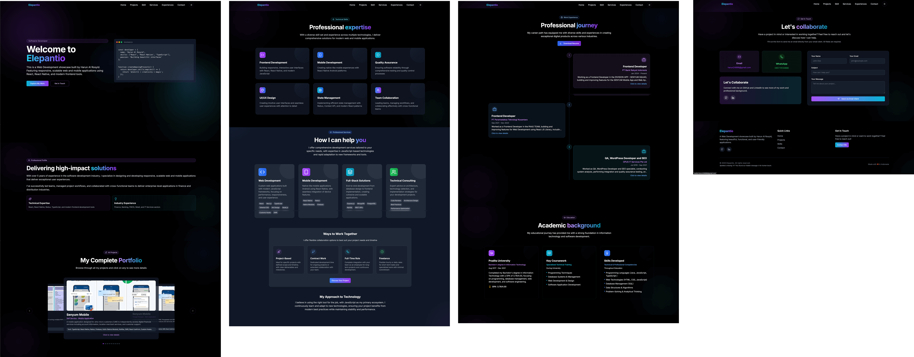
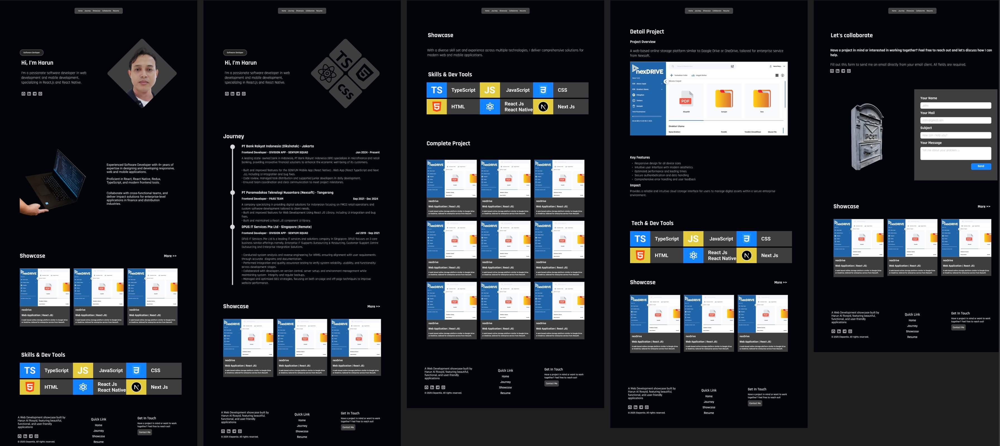
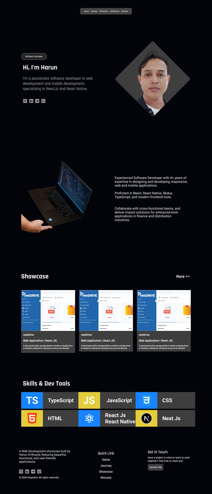
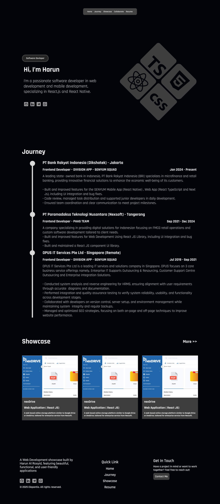
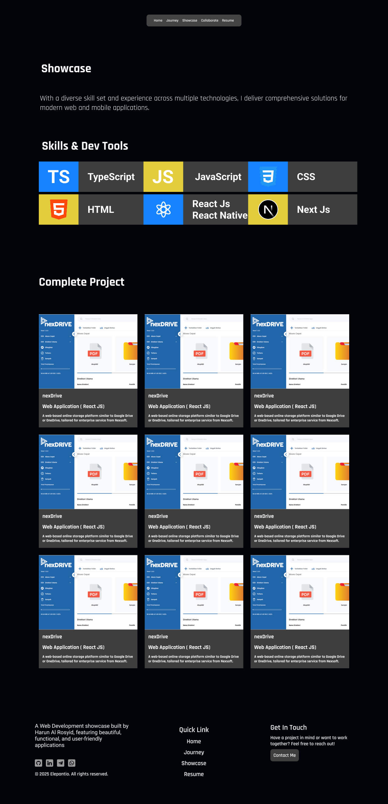
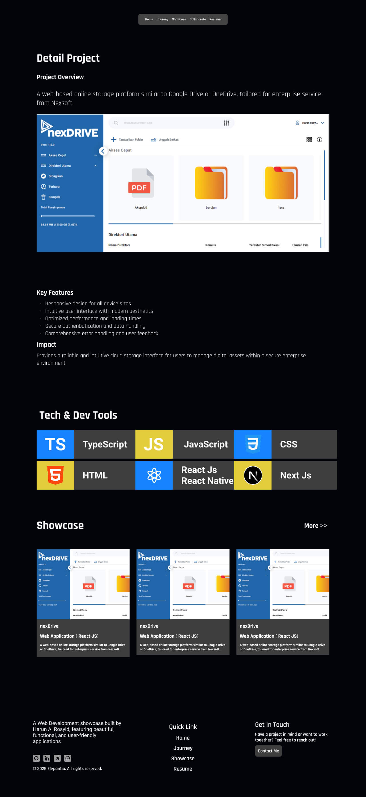
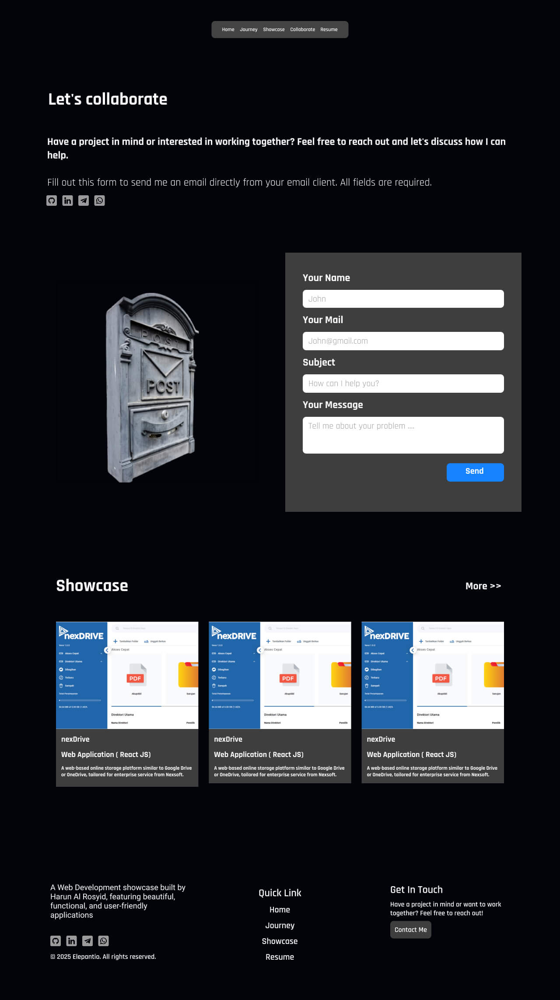

# harunalrosyid.com

## Table of Contents

- [harunalrosyid.com](#harunalrosyidcom)
  - [Table of Contents](#table-of-contents)
  - [Introduction](#introduction)
    - [My Previous Personal Website](#my-previous-personal-website)
    - [New Design](#new-design)
  - [Getting Started](#getting-started)
  - [Architecture](#architecture)
  - [Routes and URL Policy](#routes-and-url-policy)
  - [Inspirations](#inspirations)
  - [Pages](#pages)
    - [Home](#home)
    - [Journey](#journey)
    - [Showcase](#showcase)
    - [Project Detail](#project-detail)
    - [Collaborate](#collaborate)
  - [Section](#section)
  - [Tech Stack](#tech-stack)
  - [SEO and Performance](#seo-and-performance)
  - [Skills](#skills)
  - [Social Media and Contact](#social-media-and-contact)

## Introduction

This is my personal website, remake from [elepantio.com](https://elepantio.com).
That being built since 2025.

Visit my website here: [harunalrosyid.com](https://harunalrosyid.com)

I remake my personal website, to get looks to more clean, simple, with consistent layout.

### My Previous Personal Website



### New Design


[New Design](https://www.figma.com/design/U6Vze8AcafWxPuqRxNHhwa/harunalrosyid.com?node-id=0-1&p=f&t=wARenaSJuCC4mh4G-0)

## Getting Started

Use Node.js 20.19 or newer, then install dependencies and start the local server:

```sh
npm install
npm run dev
```

Build the production site with `npm run build`, then preview it with `npm run preview`. The build compiles Tailwind from `src/styles.css` into `public/output.css` before Astro builds the static pages into `dist/`.

Set `RESUME_LINK` in Vercel project settings for Production, Preview, and Development as needed, then redeploy. Locally, copy `.env.example` to `.env` and set the same variable. It is included in public HTML at build time; never store secrets in `PUBLIC_` variables.

Set `RESUME_LINK` in Vercel project settings for each deployment environment, then redeploy. For local development, copy `.env.example` to `.env` and set the same variable. This value is public and appears in the generated HTML; never put secrets in variables prefixed with `PUBLIC_`.

## Architecture

```text
src/
  components/
    atoms/                  # Small shared React components
    organisms/              # Shared Astro sections: Header, Footer, Showcase, Skills
  pages/                    # Astro pages; file paths define public routes
  styles.css                # Tailwind source and shared CSS
public/
  assets/                   # Images, icons, scripts, and downloadable files
  output.css                # Generated Tailwind stylesheet
  sitemap.xml
  robots.txt
astro.config.mjs            # Astro and React integration
vercel.json                 # Production build and clean URL settings
```

Pages use Astro for static HTML. Shared sections use Astro components; React/TypeScript is available for reusable components that need it. Keep the existing visual design and page content when editing. Reuse existing components before introducing new ones.

## Routes and URL Policy

Astro page files map to the existing public URLs. Preserve each path exactly, including spelling, capitalization, and trailing slash behavior. Vercel's `cleanUrls` setting serves generated `.html` files at extensionless URLs. Keep links, canonical URLs, Open Graph/Twitter URLs, and `sitemap.xml` aligned with those routes.

Current routes include `/`, `/journey`, `/showcase`, `/collaborate`, and each project detail under `/showcase/`.

## Inspirations

Honestly, I'm not designer. I can't create fresh and awesome design. Because my focus is building and developing applications.

To build good design for my Personal Website, Some element or component is imitation from other website.

My list website inspiration:

- [elepantio.com](https://elepantio.com)
- [theodorusclarence.com](https://theodorusclarence.com)
- [brittanychiang.com](https://brittanychiang.com)
- [kentcdodds.com](https://kentcdodds.com)

## Pages

I just create 5 page for visitor to learn about me.

### Home

Page Link [Home](https://harunalrosyid.com)

I create 5 section on Home page.

1. Introduction
2. Short Experience
3. Showcase
4. Skills
5. Footer

Preview Home:



### Journey

Page Link [Journey](https://harunalrosyid.com/journey)

This page explain about current and past my experience.

I create 4 section on Journey page.

1. Introduction
2. Journey
3. Showcase
4. Footer

Preview Journey:



### Showcase

Page Link [Showcase](https://harunalrosyid.com/showcase)

This page for explain about current and pass my complete project.

I create 4 section on Showcase page.

1. Description
2. Skills
3. All Showcase
4. Footer

Preview Showcase:



### Project Detail

Page Link [Project Detail](https://harunalrosyid.com)

This page to more detail about project.

I create 5 section on Project Detail page.

1. Description
2. Detail Project
3. Tech Stack
4. Showcase
5. Footer

Preview Project Detail:



### Collaborate

Page Link [Collaborate](https://harunalrosyid.com/collaborate)

This page include Contact Form to request collaboration and link social media.

I create 4 section on Collaborate page.

1. Description
2. Contact Form
3. Showcase
4. Footer

Preview Collaborate:



## Section

1. Introduction: short introduction about me.
2. Short Experience: short experience about me.
3. Showcase: shortcut project list.
4. Skills: tell my skill and tools development.
5. Journey: detail my journey as developer from first job and current job
6. Description: decription about page.
7. All Showcase: all project list.
8. Detail Project: detail project.
9. Tech Stack: tech stack of project.
10. Contact Form: contact form via email.
11. Footer: footer include tagline, social link and quick link navigation.

## Tech Stack

| Area                        | Technology                       |
| --------------------------- | -------------------------------- |
| Framework and routing       | Astro 5                          |
| UI components               | React 19                         |
| Language and types          | TypeScript 5                     |
| Styling                     | Tailwind CSS 4, custom CSS       |
| Build                       | Astro static build; Tailwind CLI |
| Runtime and package manager | Node.js 20.19+; npm              |
| Hosting and domain          | Vercel; Cloudflare DNS           |
| Version control             | Git and GitHub                   |

## SEO and Performance

Page metadata remains defined with each page: title, description, canonical URL, Open Graph and Twitter tags, and JSON-LD structured data. Preserve this metadata when editing routes. The public `sitemap.xml`, `robots.txt`, and analytics scripts are part of the existing setup.

- [Sitemap](https://harunalrosyid.com/sitemap.xml)
- [robots.txt](https://www.harunalrosyid.com/robots.txt)
- Google Analytics and Google Search Console
- [PageSpeed results](https://pagespeed.web.dev/analysis/https-harunalrosyid-com/qeq0t7xdv9?form_factor=desktop)
- [GTMETER results](https://gtmetrix.com/reports/www.harunalrosyid.com/JAuFmSHa/)

## Skills

- React, React Native, HTML, CSS, JavaScript, Tailwind CSS
- Redux, SWR, Custom Hooks, Ant Design, MUI, Shadcn
- React Native, Native Module (Kotlin), Firebase Cloud Messaging (FCM), Notifee
- PHP, Laravel, MySQL, PostgreSQL

## Social Media and Contact

| Social Media / Contact                                                                                      | Account / Link                                                |
| :---------------------------------------------------------------------------------------------------------- | :------------------------------------------------------------ |
|        | [harunalrosyid](https://github.com/harunalrosyid)             |
|  | [harun-alrosyid](https://www.linkedin.com/in/harun-alrosyid/) |
|  | [harunalroyid ](https://t.me/harunalroyid)                    |
